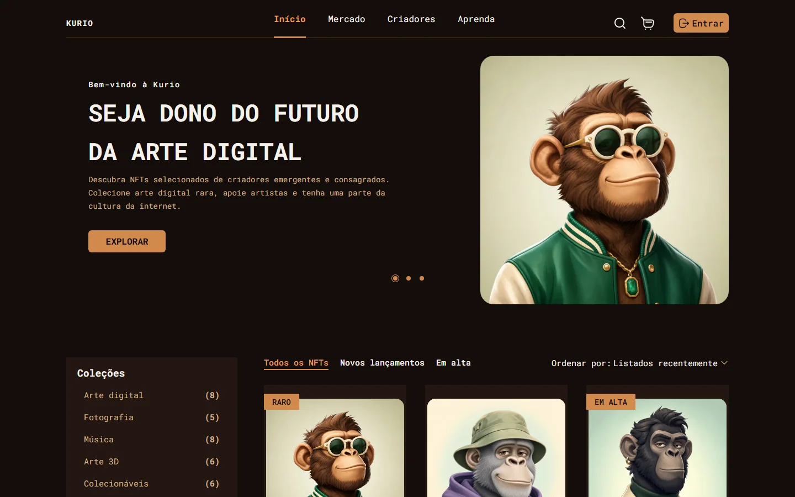
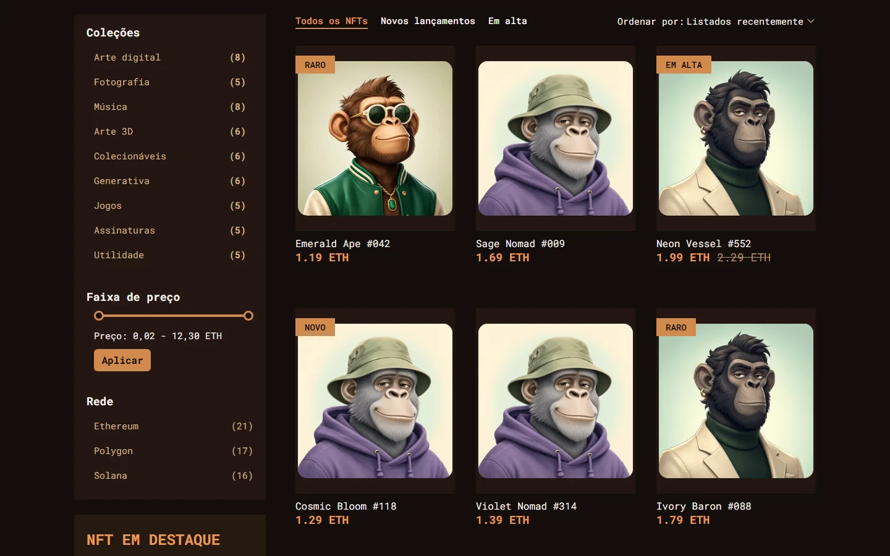
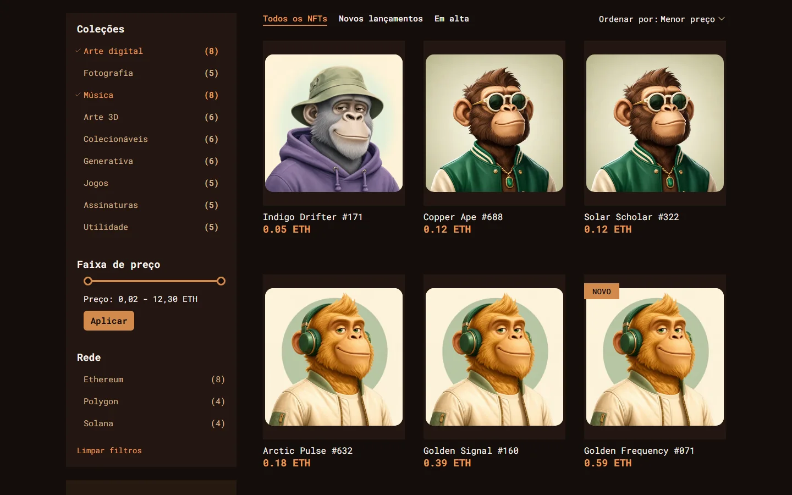
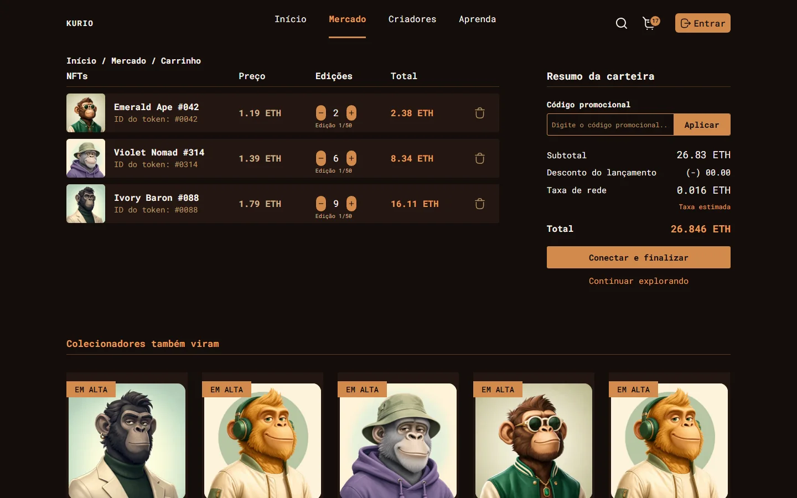
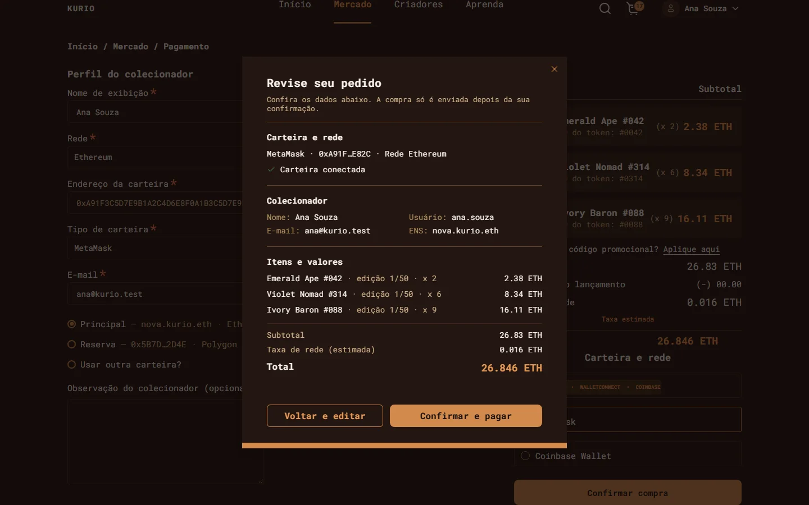
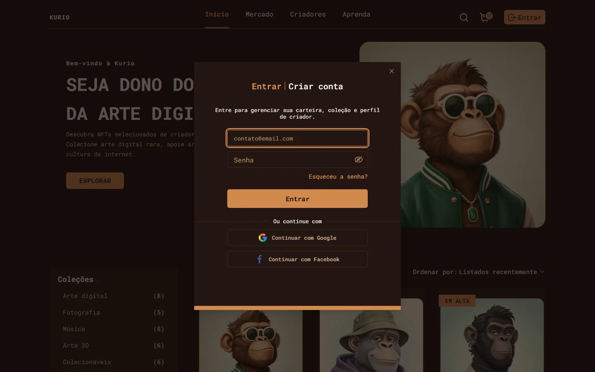
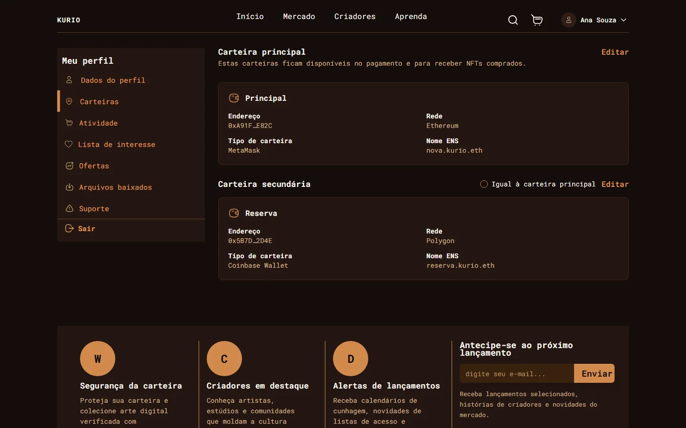
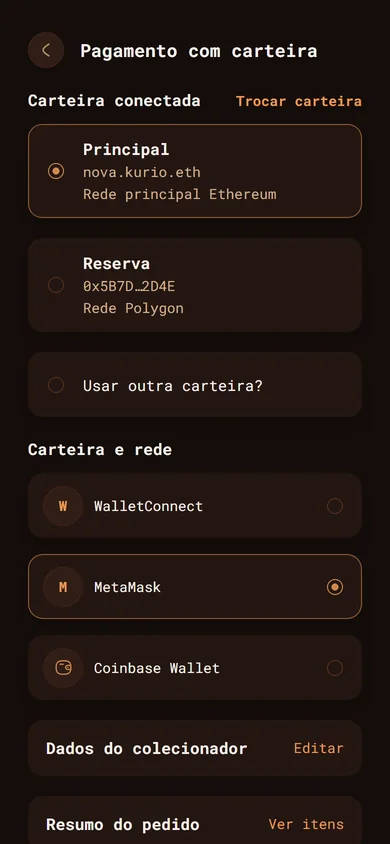

<div align="center">

# KURIO · Marketplace de NFTs

**Descoberta, compra e conta do colecionador — em desktop e mobile, com APIs, autenticação,
carteiras, pagamentos e tempo real simulados na camada de rede.**

Solução do [Desafio Frontend da Jungle Gaming](https://github.com/junglegaming/frontend-challenge),
fiel ao [layout no Figma](https://www.figma.com/design/Ff0SksUi7UFtPWUO8kyNtw/Frontend-Challenge?node-id=0-1).

[**Abrir a demonstração**](https://gabrieldevprojetos.com.br) ·
[Arquitetura](./ARCHITECTURE.md) ·
[Testes E2E](./e2e/README.md) ·
[Auditoria Lighthouse](./lighthouse/reports/SUMMARY.md)




</div>

---

## Sumário

- [Em números](#em-números)
- [Telas](#telas)
- [Stack e como cada tecnologia é usada](#stack-e-como-cada-tecnologia-é-usada)
- [Como rodar](#como-rodar)
- [Variáveis de ambiente](#variáveis-de-ambiente)
- [Credenciais fictícias e cupons](#credenciais-fictícias-e-cupons)
- [Cenários dos mocks: seleção e reset](#cenários-dos-mocks-seleção-e-reset)
- [Como reproduzir os fluxos de falha](#como-reproduzir-os-fluxos-de-falha)
- [O enunciado, item por item](#o-enunciado-item-por-item)
- [Arquitetura em resumo](#arquitetura-em-resumo)
- [Tempo real](#tempo-real)
- [Testes](#testes)
- [Performance e Lighthouse](#performance-e-lighthouse)
- [Acessibilidade](#acessibilidade)
- [Fidelidade ao Figma](#fidelidade-ao-figma)
- [Estrutura do projeto](#estrutura-do-projeto)
- [Deploy](#deploy)
- [Limitações conhecidas](#limitações-conhecidas)

## Em números

|                             |                                                                                      |
| --------------------------- | ------------------------------------------------------------------------------------ |
| **9 telas**                 | todas as do enunciado, com os frames desktop e mobile do Figma                       |
| **180 testes E2E**          | Playwright em Chromium, projetos `desktop` (1440) e `mobile` (390), todos passando   |
| **40 testes unitários**     | aritmética de ETH, guarda de eventos, utilitários dos mocks                          |
| **Lighthouse 98–100**       | nas quatro categorias, em início e detalhe, mobile e desktop (mediana de 3 medições) |
| **19 cenários**             | determinísticos de rede, sessão, carteira, compra e tempo real                       |
| **54 NFTs, 2 usuários**     | fixtures com variedade para filtros, ordenação e paginação                           |
| **0 dados fictícios na UI** | tudo vem da API simulada; o mesmo código fala com um backend real                    |

## Telas

### Desktop

<table>
  <tr>
    <td width="50%"><br><b>Catálogo</b> — busca, filtros combináveis, abas, ordenação e paginação na URL</td>
    <td width="50%"><br><b>Filtros combinados</b> — <code>?categoria=arte-digital&categoria=musica&ordem=preco-asc</code></td>
  </tr>
  <tr>
    <td><br><b>Detalhe do NFT</b> — galeria com zoom, edição na URL, limite de quantidade, favoritos</td>
    <td><br><b>Carrinho</b> — quantidades por edição, cupom e resumo calculado pela API</td>
  </tr>
  <tr>
    <td><br><b>Pagamento</b> — dados do colecionador, carteira e rede</td>
    <td><br><b>Revisão</b> — cotação revalidada e carteira conectada antes de pagar</td>
  </tr>
  <tr>
    <td><br><b>Confirmação</b> — recibo com o retrato imutável do pedido</td>
    <td><br><b>Login e cadastro</b> — diálogos com rota própria e retorno ao fluxo</td>
  </tr>
  <tr>
    <td><br><b>Perfil</b> — dados, avatar e senha</td>
    <td><br><b>Carteiras</b> — principal e secundária</td>
  </tr>
</table>

### Mobile

<table>
  <tr>
    <td></td>
    <td></td>
    <td></td>
  </tr>
  <tr>
    <td align="center">Início</td>
    <td align="center">Detalhe</td>
    <td align="center">Carrinho</td>
  </tr>
  <tr>
    <td></td>
    <td></td>
    <td></td>
  </tr>
  <tr>
    <td align="center">Login</td>
    <td align="center">Pagamento</td>
    <td align="center">Confirmação</td>
  </tr>
</table>

Perfil, carteiras, favoritos, atividade e confirmação também funcionam no mobile, mesmo sem
frame específico. Todas as telas foram verificadas em 320, 390, 414, 768, 1024, 1280, 1440 e
1920 px, sem overflow horizontal.

## Stack e como cada tecnologia é usada

| Responsabilidade      | Tecnologia                       | Onde participa                                                                                                       |
| --------------------- | -------------------------------- | -------------------------------------------------------------------------------------------------------------------- |
| Interface / linguagem | React 19 · TypeScript strict     | Toda a aplicação; contratos tipados com zod compartilhados por app e mocks                                           |
| Roteamento            | TanStack Router                  | Rotas por arquivo, busca/filtros/edição validados na URL, guarda das rotas privadas, 404, divisão de código por rota |
| Estado remoto         | TanStack Query                   | Consultas, mutations, cache por usuário, atualização otimista com rollback, sincronização com eventos                |
| Cliente HTTP          | Axios                            | Instância única: token, carrinho do visitante, tempo limite, erros tipados, expiração de sessão                      |
| Integração de dados   | REST                             | 32 endpoints documentados em [`ARCHITECTURE.md`](./ARCHITECTURE.md#3-contratos-rest)                                 |
| Tempo real            | Socket.IO (`socket.io-client`)   | `nft.updated`, `order.updated`, `wallet.updated` com identidade, recurso e versão                                    |
| Estilo                | Tailwind CSS v4                  | Tokens do Figma (cores, tipografia, raios) definidos uma vez em `globals.css`                                        |
| Componentes           | shadcn/ui (Radix)                | Diálogos, painéis, selects, radios, abas, menus — reescritos com os tokens da Kurio                                  |
| Mocking               | MSW + `@mswjs/socket.io-binding` | REST via service worker e Socket.IO via interceptação de WebSocket, com estado único e cenários                      |
| Testes E2E / visuais  | Playwright                       | 91 testes × 2 projetos, regressão visual com baselines versionadas                                                   |
| Auditoria             | Lighthouse                       | Runner próprio: 3 medições por página e perfil, mediana, relatórios HTML/JSON                                        |
| Build                 | Vite 8                           | Build de demonstração (com mocks) e build para backend real (`--mode backend`)                                       |

## Como rodar

**Requisitos:** Node.js **22.19+** (testado com 24) e npm 10+. Nenhum serviço externo: o
backend é simulado no navegador.

```bash
npm ci                            # instala exatamente o lockfile
npm run dev                       # http://localhost:5173 com os mocks ativos
```

Para os testes E2E, instale o Chromium do Playwright uma vez: `npx playwright install chromium`.

| Comando                                   | O que faz                                                                              |
| ----------------------------------------- | -------------------------------------------------------------------------------------- |
| `npm run dev`                             | Desenvolvimento com mocks (MSW + Socket.IO simulado)                                   |
| `npm run build`                           | Gera as rotas, verifica os tipos e cria o build otimizado de demonstração (com mocks)  |
| `npm run preview`                         | Serve o build em http://localhost:4173                                                 |
| `npm run build:backend`                   | Mesmo app **sem** a camada de mocks, apontando para uma API real (`.env.backend`)      |
| `npm run typecheck`                       | Verificação de tipos (`tsc -b`)                                                        |
| `npm run lint` · `npm run lint:fix`       | ESLint (inclui regras de acessibilidade, TanStack Query e proibição de `fetch` no app) |
| `npm run format` · `npm run format:check` | Prettier                                                                               |
| `npm test`                                | Testes unitários (Vitest)                                                              |
| `npm run e2e`                             | Playwright, projetos `desktop` e `mobile`, sobre o build otimizado                     |
| `npm run e2e:ui` · `npm run e2e:report`   | Modo interativo · relatório HTML (com traces das falhas)                               |
| `npm run e2e:update`                      | Regenera as baselines da regressão visual                                              |
| `npm run lighthouse -- --build`           | Auditoria Lighthouse: início e detalhe, mobile e desktop, 3 medições, mediana          |
| `npm run assets:images`                   | Regenera as variantes AVIF/WebP das artes                                              |
| `npm run deploy` · `npm run deploy:check` | Publica o build na VPS · verifica o site publicado                                     |

A entrega foi verificada a partir de um **checkout limpo** (`git clone` + `npm ci`):
typecheck, lint, testes unitários, build, formatação e a suíte E2E completa passam.

## Variáveis de ambiente

Todas são públicas (prefixo `VITE_`) e têm valores padrão versionados em `.env.development`,
`.env.production` e `.env.backend`. Para sobrescrever localmente, crie `.env.local` a partir de
`.env.example`.

| Variável             | Padrão    | Descrição                                                                              |
| -------------------- | --------- | -------------------------------------------------------------------------------------- |
| `VITE_API_URL`       | `/api`    | Base da API REST. Com mocks, o MSW intercepta esse caminho no navegador                |
| `VITE_SOCKET_URL`    | _(vazio)_ | Origem do servidor Socket.IO; vazio = mesma origem do app                              |
| `VITE_ENABLE_MOCKS`  | `true`    | `true` inicia a camada de mocks antes das requisições. O build publicado mantém `true` |
| `VITE_MOCK_SCENARIO` | `default` | Cenário inicial dos mocks                                                              |

## Credenciais fictícias e cupons

As fixtures guardam apenas o **hash com sal** (PBKDF2-SHA-256) das senhas — nunca o texto.

| Usuário    | E-mail             | Senha        | Estado inicial                                                  |
| ---------- | ------------------ | ------------ | --------------------------------------------------------------- |
| Ana Souza  | `ana@kurio.test`   | `Kurio@2026` | 2 carteiras (Principal/Ethereum, Reserva/Polygon), 2 favoritos  |
| Bruno Lima | `bruno@kurio.test` | `Colecao#77` | sem carteiras, 1 favorito, dono do pedido confirmado `ord_1000` |

| Cupom       | Efeito                                            |
| ----------- | ------------------------------------------------- |
| `KURIO10`   | 10% de desconto                                   |
| `GENESIS`   | 0.05 ETH de desconto em compras a partir de 1 ETH |
| `RELAMPAGO` | 15%, expira 2 h depois do reset                   |
| `EXPIRADO`  | sempre expirado                                   |

Qualquer outro código é inválido. No cadastro, qualquer e-mail/usuário novo funciona;
`ana@kurio.test` e `ana.souza` geram conflito.

## Cenários dos mocks: seleção e reset

O backend simulado é configurável e **determinístico** (nenhum `Math.random`): o mesmo cenário
reproduz sempre o mesmo comportamento. Há três formas de escolher um cenário:


1. **Painel "Mocks"** (imagem acima) — botão no canto inferior esquerdo; no mobile, uma aba
   estreita na borda direita. Aplica cenários, restaura os dados e dispara eventos: aumentar
   preço, esgotar edição, derrubar o socket, confirmar/recusar pedido, expirar sessão,
   desconectar carteira.
2. **URL** — `/?scenario=<id>` aplica o cenário; `/?reset` restaura os dados iniciais;
   `/?scenario=<id>&reset` faz os dois. Os parâmetros somem da URL em seguida.
3. **Console** — `window.__kurioMocks`, por exemplo `__kurioMocks.setScenario('payment-declined')`,
   `__kurioMocks.reset()` ou `__kurioMocks.setPrice('emerald-ape-042', '1.29')`.

O estado dos mocks (catálogo, sessões, carrinhos, pedidos, perfil, carteiras) persiste em
`localStorage` para sobreviver a refresh. **Reset:** `/?reset`, o botão "Restaurar dados
iniciais" do painel ou `__kurioMocks.reset()` — volta integralmente a um estado conhecido.

<details>
<summary><b>Os 19 cenários</b></summary>

| Cenário (`id`)                | Comportamento                                                                        |
| ----------------------------- | ------------------------------------------------------------------------------------ |
| `default`                     | Tudo funciona: latência fixa de 120 ms, pagamento confirmado em 2,5 s                |
| `slow-network`                | Toda resposta demora 2,5 s (skeletons e estados de envio)                            |
| `variable-latency`            | Latência pseudoaleatória com semente fixa, 150 ms – 1,8 s                            |
| `out-of-order`                | Cada requisição responde mais rápido que a anterior: respostas antigas chegam depois |
| `offline`                     | Falha de conexão em toda requisição                                                  |
| `timeout`                     | O catálogo nunca responde; o cliente desiste após 15 s                               |
| `empty-catalog`               | Listagem com sucesso e zero itens                                                    |
| `server-error`                | Catálogo responde 500 sempre                                                         |
| `flaky-catalog`               | 503, 503 e depois sucesso                                                            |
| `favorite-failure`            | A primeira alteração de favoritos falha (rollback da atualização otimista)           |
| `session-expires-at-checkout` | A sessão é encerrada no instante do envio da compra                                  |
| `wallet-rejected`             | A carteira recusa a conexão                                                          |
| `wallet-disconnects`          | A carteira conecta e cai 4 s depois                                                  |
| `price-change-at-checkout`    | O preço do 1º item sobe 0.1 ETH no envio da compra                                   |
| `sold-out-at-checkout`        | O 1º item esgota no envio da compra                                                  |
| `order-timeout`               | O pedido é criado, mas a primeira resposta nunca chega                               |
| `payment-declined`            | O pedido fica pendente e é recusado                                                  |
| `payment-pending`             | O pedido fica pendente até ser confirmado/recusado pelo painel                       |
| `socket-outage`               | O Socket.IO fica inacessível por 6 s logo após criar o pedido                        |

</details>

## Como reproduzir os fluxos de falha

Use o painel "Mocks" ou abra a URL indicada. Para voltar ao normal, `/?reset`.

| Fluxo                            | Passos                                                                                            | Resultado esperado                                                                              |
| -------------------------------- | ------------------------------------------------------------------------------------------------- | ----------------------------------------------------------------------------------------------- |
| Skeletons e rede lenta           | `/?scenario=slow-network&reset` e navegue                                                         | Skeletons com shimmer no catálogo, detalhe e resumo; nenhum salto de layout                     |
| Catálogo vazio                   | `/?scenario=empty-catalog`                                                                        | "Nenhum NFT encontrado"                                                                         |
| Erro e recuperação               | `/?scenario=flaky-catalog`                                                                        | Estado de erro → "Tentar novamente" → catálogo carrega                                          |
| Sem conexão / timeout            | `/?scenario=offline` ou `timeout`                                                                 | Mensagem de falha com nova tentativa (timeout após 15 s)                                        |
| Respostas fora de ordem          | `/?scenario=out-of-order`, troque filtros rapidamente                                             | A grade termina no último filtro escolhido                                                      |
| Conflito de cadastro             | `/cadastro` com `ana@kurio.test`                                                                  | Erro da API no campo de e-mail                                                                  |
| Cupom inválido / expirado        | No carrinho, aplique `NADA` ou `EXPIRADO`                                                         | Mensagem associada ao campo                                                                     |
| Falha ao favoritar               | Entre como Ana, `/?scenario=favorite-failure`, clique no coração                                  | O coração muda, a API falha e ele volta, com aviso; a 2ª tentativa funciona                     |
| Sessão expirada                  | Logado, painel → "Expirar sessão" e navegue; ou `session-expires-at-checkout` e confirme a compra | Aviso, redirecionamento para `/entrar` e retorno ao ponto de origem com o formulário preservado |
| Acesso não autorizado            | Como Ana, abra `/pedido/ord_1000` (pedido do Bruno)                                               | "Este pedido pertence a outra conta"                                                            |
| Preço muda no carrinho/checkout  | Com item no carrinho, painel → "Aumentar preço em 0.1 ETH"                                        | Aviso em tempo real, resumo atualizado e confirmação bloqueada até aceitar os novos valores     |
| Cotação recusada pela API        | `price-change-at-checkout` ou `sold-out-at-checkout`, confirme a compra                           | 409: a revisão mostra a mudança (ou o item esgotado); nenhum pedido é criado                    |
| Clique repetido                  | Clique várias vezes em "Confirmar e pagar"                                                        | Um único pedido                                                                                 |
| Timeout após criar o pedido      | `order-timeout`, confirme e aguarde 15 s (ou recarregue)                                          | "Não recebemos a confirmação do envio" → "Verificar e concluir" recupera **o mesmo** pedido     |
| Pagamento recusado               | `payment-declined`, conclua a compra                                                              | Pendente → "Pagamento recusado"; carrinho preservado                                            |
| Pedido pendente + refresh        | `payment-pending`, conclua a compra, recarregue; depois painel → "Confirmar"                      | Continua pendente após o refresh; vira recibo ao confirmar                                      |
| Queda do socket                  | `socket-outage`, conclua a compra                                                                 | Aviso de conexão interrompida; o recibo aparece após reconectar, sem segundo pedido             |
| Carteira recusada / desconectada | `wallet-rejected` ou `wallet-disconnects`, abra a revisão                                         | Alerta com nova tentativa; confirmação bloqueada sem carteira conectada                         |

## O enunciado, item por item

Cada seção do [enunciado](https://github.com/junglegaming/frontend-challenge) e onde ela é
atendida. Os detalhes técnicos estão em [`ARCHITECTURE.md`](./ARCHITECTURE.md).

| §   | Requisito                  | Como foi atendido                                                                                                                                                                                                                                                                                                                                                                                                                                                                                                                                                                                                            |
| --- | -------------------------- | ---------------------------------------------------------------------------------------------------------------------------------------------------------------------------------------------------------------------------------------------------------------------------------------------------------------------------------------------------------------------------------------------------------------------------------------------------------------------------------------------------------------------------------------------------------------------------------------------------------------------------- |
| 1   | Escopo                     | Descoberta, compra e conta em desktop e mobile; APIs, autenticação, carteiras e pagamentos simulados. Páginas editoriais, suporte, ofertas e downloads levam a uma página "em breve" que diz isso — nada aparenta sucesso falso                                                                                                                                                                                                                                                                                                                                                                                              |
| 2   | Stack obrigatória          | Todas as 12 tecnologias participam efetivamente (tabela acima)                                                                                                                                                                                                                                                                                                                                                                                                                                                                                                                                                               |
| 3   | Telas e fluxos             | As 9 telas, com frames desktop e mobile. **Catálogo:** busca, filtros, ordenação e página na URL, refresh e histórico; filtro zera a página; vazio, falha e respostas fora de ordem. **Detalhe:** acesso direto, NFT inexistente, edição indisponível, limite de quantidade. **Carrinho:** por edição, refresh e login preservam itens, cupom, valores da API, mudanças em tempo real. **Pagamento:** validação, revisão, carteiras com conexão/recusa/desconexão, revalidação, pedido único, pendente/confirmado/recusado, recibo imutável. **Conta:** cadastro, login, logout, sessão recuperável e expiração com retomada |
| 4   | Integração e estado        | Router (rotas, busca, guarda), Query (cache por usuário e por parâmetros, invalidação, cancelamento de respostas obsoletas), Axios (instância única). Atualização otimista com rollback em favoritos e carrinho. Política de cache/retry documentada                                                                                                                                                                                                                                                                                                                                                                         |
| 5   | Contratos REST             | 32 endpoints com esquemas zod compartilhados; erros de validação, sessão, permissão, inexistente, conflito e falha transitória; pedido idempotente com `Idempotency-Key` (mesma chave + mesmo corpo = mesmo pedido; corpo diferente = 409)                                                                                                                                                                                                                                                                                                                                                                                   |
| 6   | Mocking com MSW            | Mocks na camada de rede; estado único entre catálogo, favoritos, carrinho, perfil, carteiras e pedidos; persistência e reset; 19 cenários; fixtures com 54 NFTs e 2 usuários; Socket.IO via `@mswjs/socket.io-binding`; ativado por configuração                                                                                                                                                                                                                                                                                                                                                                             |
| 7   | Tempo real                 | `nft.updated` e `order.updated` (e `wallet.updated`) com identidade, recurso e versão; duplicatas e eventos antigos descartados; reconciliação por REST na reconexão; isolamento entre sessões; listeners liberados; queda com pedido pendente                                                                                                                                                                                                                                                                                                                                                                               |
| 8   | Interface e acessibilidade | Fidelidade medida contra o Figma; 390/768/1440 e outras larguras; skeletons com shimmer; movimento reduzido; teclado, foco, semântica, alternativas textuais, contraste, feedback acessível, zoom de 200%                                                                                                                                                                                                                                                                                                                                                                                                                    |
| 9   | Testes com Playwright      | Os 12 cenários exigidos, em desktop e mobile, + regressão visual de início, detalhe, carrinho e pagamento. Estado isolado, relógio e eventos controlados, relatório HTML e traces ([mapa](./e2e/README.md#coverage-of-the-challenge-statement-section-9))                                                                                                                                                                                                                                                                                                                                                                    |
| 10  | Performance e Lighthouse   | Início e detalhe, mobile e desktop, build otimizado, 3 medições, mediana; LCP, CLS e TBT; configuração versionada, relatórios HTML/JSON, versões e ambiente ([resumo](./lighthouse/reports/SUMMARY.md))                                                                                                                                                                                                                                                                                                                                                                                                                      |
| 11  | Critérios de avaliação     | Não exige entrega própria; esta tabela, os testes, a auditoria e o [`ARCHITECTURE.md`](./ARCHITECTURE.md) são a evidência de cada critério                                                                                                                                                                                                                                                                                                                                                                                                                                                                                   |
| 12  | Entrega                    | Código, lockfile, assets, mocks, fixtures, testes e auditoria versionados; deploy público com acesso direto e refresh; este README e o [`ARCHITECTURE.md`](./ARCHITECTURE.md); execução a partir de checkout limpo                                                                                                                                                                                                                                                                                                                                                                                                           |

## Arquitetura em resumo

```
┌────────────────────────────── navegador ───────────────────────────────┐
│ UI           routes/ (params, busca, guardas) → features/*/página       │
│              components/ (apresentação, só props)                       │
│                        ▲ hooks de feature (queries.ts)                  │
│ Estado       TanStack Query — cache por identidade  ◄─ realtime/sync.ts │
│                        ▲                                   ▲            │
│ Transporte   Axios (lib/http)                     socket.io-client       │
├────────────────────────┼───────────────────────────────────┼────────────┤
│ Mocks (MSW)  service worker → handlers → domínio → banco em memória      │
│              banco → barramento de eventos → servidor Socket.IO          │
└──────────────────────────────────────────────────────────────────────────┘
```

- **Um contrato, dois lados.** `src/contracts` define com zod todos os recursos REST e eventos;
  aplicação e mocks importam os mesmos esquemas.
- **Nenhum dado fictício fora de `src/mocks`.** Com `VITE_ENABLE_MOCKS=false` o mesmo código fala
  com um backend real, e o código dos mocks nem é baixado.
- **Eventos nunca chegam aos componentes.** `socket.io-client → guarda de eventos → cache do
TanStack Query → UI`, o mesmo caminho de uma resposta REST.
- **Dinheiro é string.** ETH trafega como string decimal; as contas usam `BigInt` em wei.
- **A URL é o estado do catálogo** e o cache é separado por usuário (`['private', escopo, …]`):
  logout e troca de usuário removem tudo da sessão anterior.
- **Pedido único em três camadas:** trava síncrona na página, `Idempotency-Key` persistida até
  uma resposta definitiva e recusa de um segundo pedido enquanto houver um pendente.

Contratos REST, eventos, política de sessão, carrinho, cache, reconciliação, transporte dos
mocks, decisões de UX e desvios do Figma: [`ARCHITECTURE.md`](./ARCHITECTURE.md).

## Tempo real

| Evento           | Efeito                                                                                                |
| ---------------- | ----------------------------------------------------------------------------------------------------- |
| `nft.updated`    | Preço e disponibilidade atualizados no catálogo, no detalhe, nos favoritos e no carrinho, com aviso   |
| `order.updated`  | Estado do pedido atualizado; recibo ao confirmar, recusa com motivo; carrinho e estoque reconciliados |
| `wallet.updated` | Carteira desconectada bloqueia a confirmação até reconectar                                           |

O cenário do enunciado funciona de ponta a ponta: com um NFT no carrinho, o preço muda (painel
"Mocks" → "Aumentar preço em 0.1 ETH"), a interface avisa e atualiza o resumo, e o checkout
bloqueia a confirmação até o colecionador aceitar os novos valores. Se a cotação antiga chegar à
API mesmo assim, ela responde 409 com a cotação nova. Uma queda de conexão com pedido pendente é
recuperada por REST (consulta a cada 5 s com o socket fora e reconciliação ao reconectar), sem
criar outra compra. O transporte simulado e suas limitações estão documentados em
[`ARCHITECTURE.md`](./ARCHITECTURE.md#transporte-socketio-na-simulação-e-limitações).

## Testes

**Playwright** — 91 testes em 13 arquivos, executados nos projetos `desktop` (1440×900) e
`mobile` (390×844): **180 passam**; 2 execuções são puladas por desenho (um teste só de mobile e
uma verificação só de desktop). Cada teste começa em um contexto limpo; REST passa pelos handlers
MSW e tempo real pelo `socket.io-client` real; relógio, latência e eventos são controlados nos
cenários sensíveis a tempo.

| Requisito do enunciado (§9)                                  | Arquivo                    |
| ------------------------------------------------------------ | -------------------------- |
| 1. Busca, filtros, ordenação, paginação e histórico          | `catalog.spec.ts`          |
| 2. Acesso direto ao detalhe e recurso inexistente            | `nft-detail.spec.ts`       |
| 3. Cadastro, login, expiração, logout e troca de usuário     | `auth.spec.ts`             |
| 4. Favoritos com falha de mutation e recuperação             | `favorites.spec.ts`        |
| 5. Carrinho, quantidades, remoção, cupom e persistência      | `cart.spec.ts`             |
| 6. Compra completa, do catálogo ao recibo                    | `purchase.spec.ts`         |
| 7. Pagamento recusado, clique repetido e timeout             | `payment-failures.spec.ts` |
| 8. Perfil, avatar, senha e carteiras com validação           | `account.spec.ts`          |
| 9. Preço/disponibilidade via Socket.IO no checkout           | `realtime.spec.ts`         |
| 10. Eventos duplicados/antigos, desconexão e pedido pendente | `realtime.spec.ts`         |
| 11. Teclado, foco de diálogos e validação                    | `a11y.spec.ts`             |
| 12. Skeletons, falha e nova tentativa                        | `resilience.spec.ts`       |
| Regressão visual (início, detalhe, carrinho, pagamento)      | `visual.spec.ts`           |
| Camada de mocks (contratos, idempotência, reset, eventos)    | `mock-layer.spec.ts`       |

```bash
npm run e2e                  # tudo, desktop + mobile
npm run e2e:report           # relatório HTML; falhas guardam trace, vídeo e screenshot
```

**Vitest** — 40 testes de unidade: aritmética exata de ETH, guarda de eventos (duplicatas,
versões antigas), utilitários determinísticos dos mocks e paginação do carrossel.

## Performance e Lighthouse

`npm run lighthouse -- --build` gera o build otimizado, sobe o preview, aquece o service worker e
mede cada página 3 vezes por perfil. Mediana de cada categoria:

| Perfil  | Página         | Performance | Accessibility | Best Practices |   SEO   | LCP    | CLS    | TBT    |
| ------- | -------------- | :---------: | :-----------: | :------------: | :-----: | ------ | ------ | ------ |
| mobile  | Início         |   **98**    |    **100**    |    **100**     | **100** | 1,87 s | 0,0006 | 115 ms |
| mobile  | Detalhe do NFT |   **99**    |    **100**    |    **100**     | **100** | 1,72 s | 0      | 132 ms |
| desktop | Início         |   **100**   |    **100**    |    **100**     | **100** | 0,54 s | 0,0017 | 0 ms   |
| desktop | Detalhe do NFT |   **100**   |    **100**    |    **100**     | **100** | 0,54 s | 0,0001 | 0 ms   |

Metas do enunciado: Performance ≥ 90, Accessibility ≥ 95, Best Practices ≥ 95, SEO ≥ 90 —
todas atingidas, sem simplificações exclusivas para a auditoria (imagens, fontes, mocks e tempo
real carregam normalmente). Relatórios HTML/JSON por medição, versões das ferramentas, ambiente
e condições em [`lighthouse/reports/SUMMARY.md`](./lighthouse/reports/SUMMARY.md).

O que mais pesa: um _chunk_ por rota; mocks, `socket.io-client` e o painel carregados sob
demanda; artes em AVIF/WebP responsivas com dimensões declaradas; fonte auto-hospedada;
skeletons que reservam o espaço do conteúdo (CLS ≈ 0).

## Acessibilidade

- Tudo operável por teclado, com anel de foco visível e link "Pular para o conteúdo".
- Diálogos e painéis prendem o foco e o devolvem ao elemento que os abriu — inclusive o login,
  que é uma rota.
- Rótulos associados, erros ligados por `aria-describedby`, foco no primeiro campo inválido.
- Estados que não dependem só de cor (filtros, abas, edição selecionada, esgotado).
- Mutations e mudanças em tempo real anunciadas por regiões vivas.
- `prefers-reduced-motion` respeitado em todo o app; zoom de 200% sem perda de conteúdo.
- Varreduras axe (WCAG 2.1 A/AA) em 9 telas dentro da suíte E2E; Lighthouse Accessibility 100.

## Fidelidade ao Figma

Cada frame do Figma (9 desktop, 6 mobile) foi exportado com a geometria de todas as camadas e
**comparado numericamente** com a aplicação em execução: linha de base, tamanho, peso e cor de
cada texto; posição, tamanho e raio de cada retângulo e ícone. No desktop, o resultado fica
dentro de ~1,5 px na grande maioria das camadas, e as alturas de página batem com as dos frames.
O que sobra é intencional — ajustes de acessibilidade (como áreas de toque de 24 px nos pontos
dos carrosséis), estados que o Figma não desenha ou inconsistências do próprio arquivo — e está
listado em [`ARCHITECTURE.md` › Desvios do Figma](./ARCHITECTURE.md#15-desvios-do-figma-assets-e-ajustes-de-acessibilidade).
As quatro artes originais são usadas sem substituição.

## Estrutura do projeto

```
src/
  app/            provedores, roteador, shell, efeitos globais (sessão, tempo real)
  routes/         rotas do TanStack Router (finas: params, busca na URL, guardas)
  features/       catalog · cart · checkout · orders · auth · account · realtime
    <feature>/    api.ts (Axios) · queries.ts (TanStack Query) · páginas · components/
  components/     ui/ (shadcn tematizado) · icons/ (extraídos do Figma) · layout/
  contracts/      esquemas zod + tipos compartilhados por app e mocks (REST e eventos)
  lib/            http (Axios), realtime (Socket.IO), money (ETH exato), sessão, utilitários
  mocks/          MSW: banco em memória, domínio, handlers, cenários, Socket.IO, painel
e2e/              Playwright: specs, fixtures, baselines visuais
lighthouse/       configuração, runner e relatórios da auditoria
deploy/           script de publicação e configuração do Caddy
docs/screenshots/ imagens deste README
scripts/          geração das imagens e do hash das senhas das fixtures
```

## Deploy

A demonstração roda em **https://gabrieldevprojetos.com.br** — uma VPS Ubuntu com Caddy e HTTPS
automático (o service worker do MSW exige contexto seguro). O servidor entrega os arquivos
estáticos com _fallback_ para `index.html`, então acesso direto e refresh funcionam em qualquer
rota. A versão publicada corresponde ao código deste repositório; `/version.txt` mostra a
release em execução.

```bash
bash deploy/deploy.sh setup      # uma vez por servidor: Caddy, pastas e configuração
npm run deploy                   # build + envio + troca atômica da release + verificação
bash deploy/deploy.sh rollback   # volta para a release anterior
```

O endereço do servidor não fica no repositório: `DEPLOY_HOST=usuario@host` vai em
`deploy/deploy.env` (ignorado pelo git) ou numa variável de ambiente; `DEPLOY_DOMAIN` e
`DEPLOY_SSH_OPTS` completam a configuração (ver o cabeçalho de `deploy/deploy.sh`). O build é
estático e também funciona em Vercel, Netlify e Cloudflare Pages: `vercel.json` e
`public/_redirects` já trazem o _fallback_ de SPA.

## Limitações conhecidas

- O backend simulado vive no navegador: os dados não são compartilhados entre dispositivos, e
  limpar os dados do site equivale a um reset.
- A simulação de Socket.IO acontece por aba: eventos não atravessam abas (o estado REST, sim).
- Sem blockchain, carteiras ou gateways reais, conforme o escopo — endereços, hashes e o
  explorador são fictícios.
- Uma compra pendente por vez por colecionador, de propósito: o carrinho mantém os itens até a
  confirmação sem risco de compra em dobro.

A lista completa, com os motivos, está em [`ARCHITECTURE.md`](./ARCHITECTURE.md#16-limitações-conhecidas).
